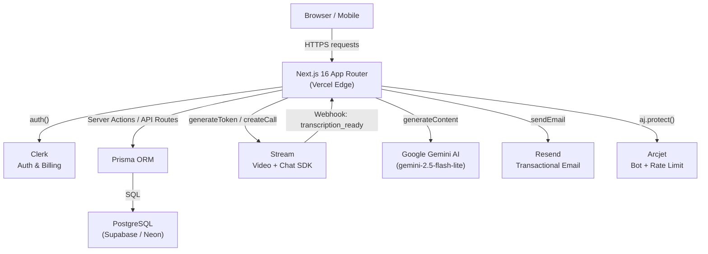
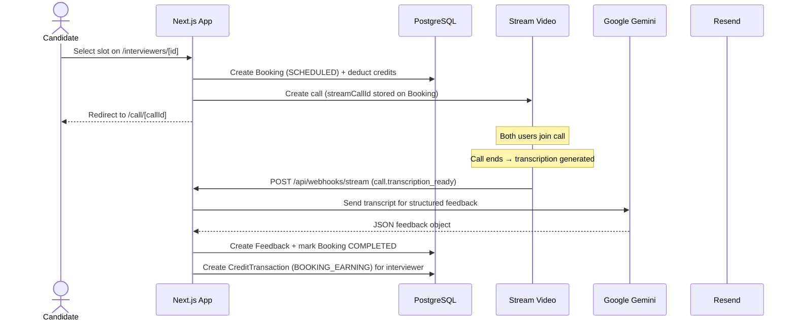
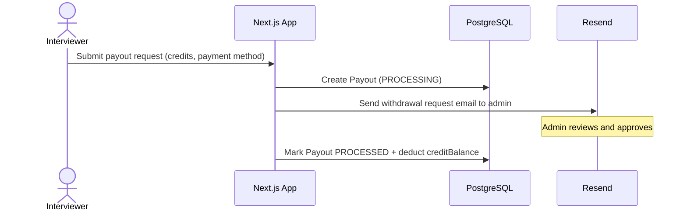

# Architecture Overview

This document describes the high-level system design of **Prept**, an AI-powered mock interview marketplace built on Next.js 16.

---

## High-Level Architecture



---

## Booking Data Flow



---

## Payout Flow



---

## Database Entity Relationships

```mermaid
erDiagram
    User {
        string id PK
        string clerkUserId UK
        string email UK
        UserRole role
        int credits
        string currentPlan
        int creditBalance
    }

    Availability {
        string id PK
        string interviewerId FK
        datetime startTime
        datetime endTime
        AvailabilityStatus status
    }

    Booking {
        string id PK
        string intervieweeId FK
        string interviewerId FK
        datetime startTime
        datetime endTime
        BookingStatus status
        int creditsCharged
        string streamCallId UK
    }

    Feedback {
        string id PK
        string bookingId FK UK
        string summary
        FeedbackRating overallRating
    }

    CreditTransaction {
        string id PK
        string userId FK
        int amount
        TransactionType type
        string bookingId FK
    }

    Payout {
        string id PK
        string interviewerId FK
        int credits
        float netAmount
        PayoutStatus status
    }

    User ||--o{ Availability : "sets"
    User ||--o{ Booking : "books as interviewee"
    User ||--o{ Booking : "conducts as interviewer"
    Booking ||--o| Feedback : "generates"
    User ||--o{ CreditTransaction : "has"
    Booking ||--o{ CreditTransaction : "triggers"
    User ||--o{ Payout : "requests"
```

---

## Key Design Decisions

| Decision | Rationale |
|----------|-----------|
| **Next.js Server Actions** for all mutations | Removes the need for a separate API layer; type-safe, co-located with components |
| **Single `User` model** for both roles | Avoids join complexity; role-specific fields are simply `null` for the other role |
| **Stream for video + chat** | Managed WebRTC + persistent chat in one SDK; webhook delivers transcripts |
| **Credits as integers** in the DB | Avoids floating-point rounding errors for financial logic |
| **Arcjet at the middleware layer** | Protects all API routes without touching individual handlers |
| **Prisma 7 with `@prisma/adapter-pg`** | Native PostgreSQL driver for serverless environments (no connection pool bloat) |
